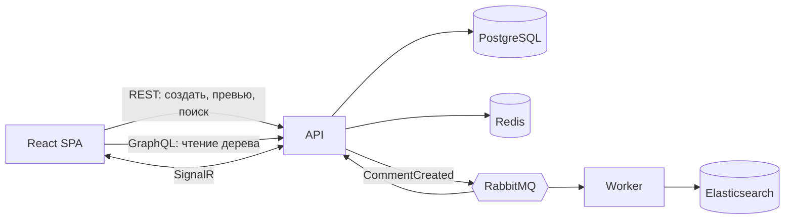

# Comments — SPA «Комментарии»

Тестовое задание: SPA-приложение комментариев (.NET 9 / ASP.NET Core / React). Реализован уровень **Middle**
с проработкой **Middle+** (см. [docs/ARCHITECTURE.md](docs/ARCHITECTURE.md)).

## Возможности

- Комментарии и каскадные ответы любой вложенности; форма: User Name (латиница+цифры), E-mail, Homepage (необязательно), CAPTCHA (картинка), Text.
- Главная: таблица корневых комментариев с сортировкой по **User Name / E-mail / дате** (в обе стороны), **25 на странице**, по умолчанию **LIFO**.
- Разрешённые теги: `<a href title>`, `<code>`, `<i>`, `<strong>`; проверка закрытия и вложенности, валидный XHTML на выходе. Панель кнопок `[i] [strong] [code] [a]`.
- **Предпросмотр** без перезагрузки страницы (тот же санитайзер, что и при сохранении).
- Вложения: JPG/GIF/PNG (пропорционально уменьшаются до **320×240**), TXT до **100 КБ**. Просмотр — лайтбокс с анимациями.
- Валидация на клиенте и на сервере. Защита от **XSS** (whitelist-санитайзер + DOMPurify + CSP) и **SQL-инъекций** (только параметризованные запросы EF Core).
- Данные пользователя (имя, e-mail, homepage, IP, User-Agent) сохраняются в реляционной БД.
- Live-обновления (SignalR), полнотекстовый поиск (Elasticsearch), GraphQL для чтения.

## Стек и соответствие требованиям

| Требование | Реализация |
|---|---|
| .NET (последняя), EF, OOP | .NET 9, ASP.NET Core, EF Core 9, слои Domain/Application/Infrastructure/Api/Worker |
| SQL | PostgreSQL 17 |
| Frontend | React 18 + TypeScript + Vite |
| Docker, Git | `docker-compose.yml`, GitHub Actions CI |
| Queue, Events | RabbitMQ (MassTransit), событие `CommentCreated` |
| Cache | Redis (страницы списка, CAPTCHA) |
| WebSocket | SignalR |
| Graph | GraphQL (HotChocolate) на `/graphql` |
| NoSQL | Elasticsearch (поиск) |
| Cloud | VDS + Docker Compose + Caddy (авто-HTTPS); файлы за интерфейсом `IFileStorage` (готово к S3) |
| Middle+ | [docs/ARCHITECTURE.md](docs/ARCHITECTURE.md) + нагрузочный тест k6 |



## Быстрый старт (Docker)

Требования: Docker + Docker Compose; для Elasticsearch ~4 ГБ RAM.

```bash
git clone <repo> && cd CommentsApp
cp .env.example .env          # задайте DB_PASSWORD и RABBITMQ_PASSWORD
docker compose up --build -d
```

Откройте http://localhost (порт 80). Первый запуск собирает образы несколько минут; БД мигрируется автоматически.

На сервере (Linux) для Elasticsearch: `sudo sysctl -w vm.max_map_count=262144`.

### Первичная подготовка репозитория (один раз, разработчику)

Миграции EF и solution-файл создаются скриптом и **коммитятся в репозиторий**:

```bash
dotnet tool install -g dotnet-ef
./setup.sh                    # solution + миграция Initial + тесты
cd web && npm install && cd ..   # создаст package-lock.json — тоже закоммитить
git add -A && git commit -m "Initial migration and lockfile"
```

## Деплой на VDS

1. Установите Docker, откройте порты 80/443. Выполните `sysctl` из раздела выше.
2. Клонируйте репозиторий, `cp .env.example .env`, задайте пароли и **`SITE_ADDRESS=ваш.домен`** (DNS должен указывать на VDS) — Caddy сам получит сертификат.
3. `docker compose up --build -d`.
4. Резервные копии БД: cron `0 3 * * * /путь/к/проекту/deploy/backup.sh`.

Наружу публикуется только Caddy (80/443); API слушает `127.0.0.1:8080`, веб-консоль RabbitMQ — `127.0.0.1:15672`.

## Разработка

```bash
docker compose up -d postgres redis rabbitmq elasticsearch   # инфраструктура
dotnet run --project src/Comments.Api                         # API (БД мигрируется при старте)
dotnet run --project src/Comments.Worker                      # индексация
cd web && npm install && npm run dev                          # http://localhost:5173
```

> Vite проксирует `/api`, `/graphql`, `/hubs` на `localhost:8080`. При `dotnet run` порт API другой —
> задайте `ASPNETCORE_URLS=http://localhost:8080` или поправьте `web/vite.config.ts`.

Тесты: `dotnet test` (санитайзер, валидатор, дерево, текст для индекса), `cd web && npm test` (валидация, дерево).

## API

| Метод | Путь | Назначение |
|---|---|---|
| GET | `/api/captcha` | новая CAPTCHA `{id, imageDataUri}` |
| POST | `/api/comments` | создать комментарий (`multipart/form-data`: userName, email, homepage, text, parentId, captchaId, captchaAnswer, file) |
| POST | `/api/comments/preview` | предпросмотр `{text}` → `{html}` |
| GET | `/api/search?q=&page=` | поиск |
| GET | `/api/attachments/{id}` | файл вложения |
| POST | `/graphql` | чтение: `comments(sortBy, desc, page)` |
| WS | `/hubs/comments` | событие `commentCreated` |

```graphql
{
  comments(sortBy: CREATED_AT, desc: true, page: 1) {
    totalCount
    items { id userName email textHtml createdAt attachments { id kind originalName }
            descendants { id parentId userName textHtml createdAt } }
  }
}
```

## Нагрузочный тест

k6 запускается в Docker; override-файл отключает CAPTCHA и лимиты запросов — **только для тестового стенда**.

```bash
docker compose -f docker-compose.yml -f docker-compose.loadtest.yml up -d --build
docker compose -f docker-compose.yml -f docker-compose.loadtest.yml run --rm \
  -e WRITE_RPS=120 -e READ_RPS=600 -e DURATION=3m k6 run /scripts/k6-comments.js
```

Профили и пороги — в [docs/ARCHITECTURE.md](docs/ARCHITECTURE.md). После теста верните обычный режим: `docker compose up -d --build`.

## Схема БД

- PostgreSQL: [docs/db-schema.sql](docs/db-schema.sql)
- Для MySQL Workbench: [docs/db-schema.mysql.sql](docs/db-schema.mysql.sql) → *File → Import → Reverse Engineer MySQL Create Script*, затем *Model → Create Diagram from Catalog Objects*.

## Структура

```
src/Comments.Domain          сущности и события
src/Comments.Application     сервисы, санитайзер HTML, валидация, абстракции
src/Comments.Infrastructure  EF Core, Redis, RabbitMQ, Elasticsearch, файлы, CAPTCHA
src/Comments.Api             REST, GraphQL, SignalR
src/Comments.Worker          консьюмеры (индексация)
web/                         React SPA
deploy/                      Caddyfile, backup.sh
tests/                       unit-тесты, нагрузочный тест (k6)
```

## Самопроверка (чек-лист)

- [ ] `docker compose up --build -d` с нуля, страница открывается
- [ ] Комментарий создаётся, CAPTCHA одноразовая; ответ на ответ отображается каскадом
- [ ] Сортировка по трём колонкам в обе стороны; 25 на странице; по умолчанию новые сверху
- [ ] `<script>`, `<i>` без закрытия, `javascript:` в ссылке — не проходят/экранируются
- [ ] Картинка 1000×800 уменьшается до ≤320×240; TXT >100 КБ отклоняется
- [ ] Предпросмотр, панель тегов, лайтбокс, live-обновление во второй вкладке, поиск
