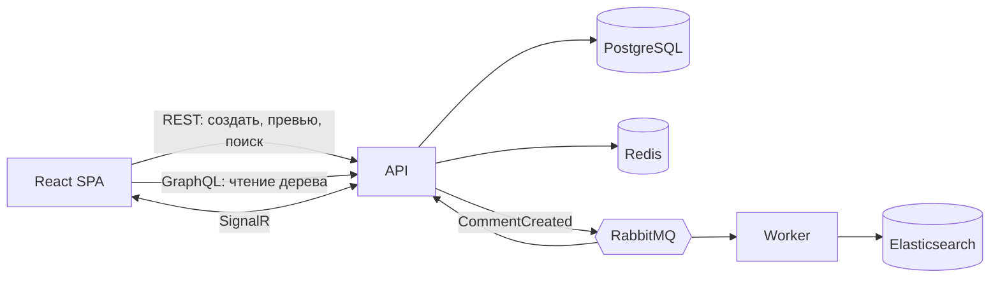

# Comments — SPA «Комментарии»

Тестовое задание: SPA-приложение комментариев на **.NET 9 / ASP.NET Core** и **React**.
Реализован уровень **Middle** с проработкой **Middle+** (архитектура под 1 млн сообщений и 100 тыс. пользователей в сутки —
см. [docs/ARCHITECTURE.md](docs/ARCHITECTURE.md)).

## Содержание

- [Возможности](#возможности)
- [Стек и соответствие требованиям](#стек-и-соответствие-требованиям)
- [Быстрый старт (Docker)](#быстрый-старт-docker) — достаточно Docker, больше ничего ставить не нужно
- [Режим разработки](#режим-разработки)
- [Деплой на VDS](#деплой-на-vds)
- [Если что-то не работает](#если-что-то-не-работает)
- [API](#api) · [Тесты](#тесты) · [Нагрузочный тест](#нагрузочный-тест) · [Схема БД](#схема-бд) · [Структура](#структура-репозитория)
- [Ограничения](#известные-ограничения) · [Самопроверка](#самопроверка-чек-лист)

## Возможности

**Комментарии**
- Комментарии и ответы любой вложенности (каскадное отображение).
- Форма: User Name (латиница и цифры), E-mail, Homepage (необязательно), CAPTCHA (картинка), Text.
- Разрешённые теги: `<a href title>`, `<code>`, `<i>`, `<strong>`. Проверка закрытия и вложенности, на выходе валидный XHTML.
  Панель кнопок `[i] [strong] [code] [a]`, **предпросмотр** без перезагрузки страницы (тот же санитайзер, что и при сохранении).
- Вложения: JPG / GIF / PNG (пропорционально уменьшаются до **320×240**) и TXT до **100 КБ**.
  Просмотр в лайтбоксе с анимациями.
- Данные автора (имя, e-mail, homepage, IP, User-Agent) сохраняются в реляционной БД.

**Главная страница**
- Два вида (переключатель **Cards / Table**): карточки «как в мессенджере» — **ваши сообщения справа, чужие слева** — или таблица заглавных комментариев.
- Сортировка по **имени, e-mail и дате** в обе стороны, по умолчанию LIFO (новые сверху), **25 на странице**.
- Live-обновления через SignalR: новые комментарии появляются без перезагрузки.
- Полнотекстовый поиск (Elasticsearch).
- Кнопка «✎ New comment» всегда под рукой при прокрутке; имя и e-mail запоминаются в пределах вкладки
  (в новой вкладке можно писать от другого имени; опционально «Remember me» — для всех вкладок).

**Безопасность и качество**
- **XSS:** whitelist-санитайзер на сервере, DOMPurify на клиенте, заголовки CSP.
- **SQL-инъекции:** только параметризованные запросы (EF Core).
- Валидация на клиенте и на сервере; CAPTCHA одноразовая; ограничение частоты запросов по IP.
- Файлы: тип проверяется по содержимому, из картинок удаляются метаданные (EXIF).

## Стек и соответствие требованиям

| Требование | Реализация |
|---|---|
| .NET (последняя), Entity Framework, OOP | .NET 9, ASP.NET Core, EF Core 9; слои Domain / Application / Infrastructure / Api / Worker |
| SQL | PostgreSQL 17 |
| Frontend | React 18 + TypeScript + Vite |
| Docker, Git | `docker-compose.yml`, GitHub Actions (CI) |
| Queue, Events | RabbitMQ (MassTransit), событие `CommentCreated` |
| Cache | Redis (страницы списка, CAPTCHA) |
| WebSocket | SignalR |
| Graph | GraphQL (HotChocolate), `/graphql` |
| NoSQL | Elasticsearch (поиск) |
| Cloud | VDS + Docker Compose + Caddy (автоматический HTTPS); файлы за интерфейсом `IFileStorage` (готово к S3) |
| Middle+ | [docs/ARCHITECTURE.md](docs/ARCHITECTURE.md) + нагрузочный тест k6 |



## Быстрый старт (Docker)

Этот способ запускает **всё приложение** целиком. Нужен только Docker; .NET и Node.js ставить не требуется.

**Требования**
- Docker Desktop (Windows / macOS) или Docker Engine + Compose (Linux). Docker должен быть **запущен**.
- Около **4 ГБ свободной памяти** (Elasticsearch) и свободные порты **80** и **443**.
- Git.

**Шаги**

```bash
git clone <адрес-репозитория>
cd CommentsApp
```

Создайте файл `.env` из шаблона:

```bash
# Linux / macOS / WSL / Git Bash
cp .env.example .env
```
```powershell
# Windows PowerShell
Copy-Item .env.example .env
```

Откройте `.env` и задайте пароли (для локального запуска подойдёт любое значение):

```
DB_PASSWORD=app
RABBITMQ_PASSWORD=app
SITE_ADDRESS=:80
```

Запустите:

```bash
docker compose up --build -d
docker compose ps        # все сервисы должны быть Up / healthy
```

Первая сборка занимает несколько минут (скачиваются образы, собираются .NET и React). База данных создаётся и мигрируется автоматически.

Откройте **http://localhost**. Остановка: `docker compose down` (данные сохраняются), полный сброс вместе с данными: `docker compose down -v`.

**Linux:** для Elasticsearch один раз выполните `sudo sysctl -w vm.max_map_count=262144`.
**Windows (Docker Desktop, WSL 2):** при проблемах с Elasticsearch — `wsl -d docker-desktop sysctl -w vm.max_map_count=262144`.

### Какие адреса доступны

| Адрес | Что это |
|---|---|
| http://localhost | приложение |
| http://localhost:8080/graphql | GraphQL IDE (только с этого компьютера) |
| http://localhost:8080/health | проверка работоспособности API |
| http://localhost:15672 | консоль RabbitMQ (логин `app`, пароль из `RABBITMQ_PASSWORD`) |

## Режим разработки

Инфраструктура работает в Docker, а API, Worker и фронтенд запускаются локально (с отладкой).

**Требования:** [.NET 9 SDK](https://dotnet.microsoft.com/download), [Node.js 22](https://nodejs.org/), Docker, Git.
Для Visual Studio — версия 2022 17.12+ (или 2026) с рабочей нагрузкой «ASP.NET и веб-разработка».

> В `.env` для этого режима должны быть значения `DB_PASSWORD=app` и `RABBITMQ_PASSWORD=app`
> (они совпадают с настройками по умолчанию в `appsettings*.json`).

**1. Инфраструктура** (порты открываются только на `127.0.0.1` через `docker-compose.dev.yml`):

```bash
docker compose -f docker-compose.yml -f docker-compose.dev.yml up -d postgres redis rabbitmq elasticsearch
docker compose ps        # дождитесь статуса healthy (Elasticsearch стартует около минуты)
```

**2. Backend** (в двух терминалах или из Visual Studio):

```bash
dotnet run --project src/Comments.Api --launch-profile Comments.Api   # http://localhost:8080, БД мигрируется при старте
dotnet run --project src/Comments.Worker                              # индексация для поиска
```

**Visual Studio:** откройте `CommentsApp.sln` → *Свойства решения → Несколько запускаемых проектов* → `Start` для
`Comments.Api` и `Comments.Worker` → профиль **Comments.Api** (не Docker) → F5.

**3. Frontend:**

```bash
cd web
npm install
npm run dev              # http://localhost:5173
```

Vite проксирует `/api`, `/graphql` и `/hubs` на `localhost:8080`.

### Новые миграции БД

Миграции лежат в репозитории (`src/Comments.Infrastructure/Persistence/Migrations`) и применяются при старте API.
Если вы меняете сущности или их конфигурации — создайте новую миграцию и закоммитьте её:

```bash
dotnet tool install -g dotnet-ef        # один раз
dotnet ef migrations add ИмяИзменения -p src/Comments.Infrastructure -s src/Comments.Api -o Persistence/Migrations
```

## Деплой на VDS

Подойдёт Ubuntu 22.04 / 24.04 с 4+ ГБ RAM.

1. Установите Docker: `curl -fsSL https://get.docker.com | sudo sh`, затем `sudo usermod -aG docker $USER` и переподключитесь по SSH.
2. Откройте порты 80 и 443 (в панели хостинга и в `ufw`). Выполните `sudo sysctl -w vm.max_map_count=262144`
   (чтобы пережило перезагрузку: `echo 'vm.max_map_count=262144' | sudo tee /etc/sysctl.d/99-es.conf`).
3. Клонируйте репозиторий и создайте `.env`: **длинные случайные** `DB_PASSWORD` и `RABBITMQ_PASSWORD`,
   а в `SITE_ADDRESS` — ваш домен (A-запись должна указывать на IP сервера). Caddy сам получит HTTPS-сертификат.
   Без домена оставьте `SITE_ADDRESS=:80`.
4. `docker compose up --build -d`.
5. Обновление: `git pull && docker compose up -d --build`.
6. Резервные копии БД: `crontab -e` и строка `0 3 * * * /путь/к/проекту/deploy/backup.sh` (хранятся 14 дней).

Наружу публикуется только Caddy (80/443). API слушает `127.0.0.1:8080`, консоль RabbitMQ — `127.0.0.1:15672`.
**Не используйте значения вроде `app` в качестве паролей на публичном сервере.**

## Если что-то не работает

| Симптом | Причина и решение |
|---|---|
| `failed to connect to the docker API` / `dockerDesktopLinuxEngine` | Docker не запущен. Запустите Docker Desktop, дождитесь «Engine running», проверьте `docker version`. |
| `required variable DB_PASSWORD is missing` | Нет файла `.env` рядом с `docker-compose.yml` (или он называется иначе, например `.env.txt`). Создайте его из `.env.example`. |
| Elasticsearch не становится healthy / падает | Не хватает памяти или не задан `vm.max_map_count` (см. выше). Освободите RAM, увеличьте лимит памяти Docker Desktop до 4+ ГБ. |
| Порт 80 или 443 занят | Другая программа (IIS, Apache, nginx). Остановите её или в `docker-compose.yml` для `proxy` поменяйте порт, например `"8081:80"`, и откройте http://localhost:8081. |
| Vite: `http proxy error ... AggregateError` | API не запущен на `localhost:8080`. Запустите его с профилем `Comments.Api`. |
| `Failed to connect to 127.0.0.1:5432` | Инфраструктура поднята без `docker-compose.dev.yml` (порты не открыты) или Docker остановлен. |
| `PendingModelChangesWarning` при старте API | Модель изменилась, а миграции нет — создайте миграцию (раздел «Новые миграции БД»). |
| Поиск ничего не находит | Не запущен Worker или Elasticsearch не healthy. Комментарии, созданные до запуска Worker, не индексируются автоматически. |
| Капча не загружается | Посмотрите `docker compose logs api`; проверьте, что Redis healthy. |
| Хочется начать с чистого листа | `docker compose down -v` удалит контейнеры и все данные (БД, файлы, индекс). |

## API

| Метод | Путь | Назначение |
|---|---|---|
| GET | `/api/captcha` | новая CAPTCHA `{id, imageDataUri}` |
| POST | `/api/comments` | создать комментарий (`multipart/form-data`: userName, email, homepage, text, parentId, captchaId, captchaAnswer, file) |
| POST | `/api/comments/preview` | предпросмотр `{text}` → `{html}` |
| GET | `/api/search?q=&page=` | поиск |
| GET | `/api/attachments/{id}` | файл вложения |
| POST | `/graphql` | чтение: `comments(sortBy, desc, page)` |
| WS | `/hubs/comments` | событие `commentCreated` |

Ошибки валидации — HTTP 400 в формате `ValidationProblemDetails` (`errors` по полям: `userName`, `email`, `homepage`, `text`, `captchaAnswer`, `file`, `parentId`).

Пример GraphQL-запроса (`sortBy`: `CREATED_AT`, `USER_NAME`, `EMAIL`):

```graphql
{
  comments(sortBy: CREATED_AT, desc: true, page: 1) {
    totalCount
    items {
      id userName email textHtml createdAt attachments { id kind originalName }
      descendants { id parentId userName textHtml createdAt }   # все вложенные ответы плоским списком
    }
  }
}
```

## Тесты

```bash
dotnet test                 # санитайзер, валидатор, дерево комментариев, текст для индекса
cd web && npm test          # валидация формы, построение дерева
```

CI (GitHub Actions, `.github/workflows/ci.yml`) собирает backend, прогоняет тесты и собирает фронтенд при каждом push.

## Нагрузочный тест

k6 запускается в Docker. Override-файл **отключает CAPTCHA и лимиты запросов — используйте только на тестовом стенде**.

```bash
docker compose -f docker-compose.yml -f docker-compose.loadtest.yml up -d --build
docker compose -f docker-compose.yml -f docker-compose.loadtest.yml run --rm \
  -e WRITE_RPS=120 -e READ_RPS=600 -e DURATION=3m k6 run /scripts/k6-comments.js
```

Профили и пороги (ошибок < 1 %, p95 чтения < 300 мс, p95 записи < 800 мс) описаны в [docs/ARCHITECTURE.md](docs/ARCHITECTURE.md).
После теста верните обычный режим: `docker compose up -d --build`.

## Схема БД

- PostgreSQL (рабочая): [docs/db-schema.sql](docs/db-schema.sql)
- Для MySQL Workbench: [docs/db-schema.mysql.sql](docs/db-schema.mysql.sql) → *File → Import → Reverse Engineer MySQL Create Script*, затем *Model → Create Diagram from Catalog Objects*.

Таблицы: `users` (автор и данные для идентификации клиента), `comments` (дерево через `parent_id`), `attachments`.

## Структура репозитория

```
src/Comments.Domain          сущности и события
src/Comments.Application     сервисы, санитайзер HTML, валидация, абстракции
src/Comments.Infrastructure  EF Core, Redis, RabbitMQ, Elasticsearch, файлы, CAPTCHA, обработка картинок (SkiaSharp)
src/Comments.Api             REST, GraphQL, SignalR
src/Comments.Worker          консьюмеры (индексация в Elasticsearch)
web/                         React SPA
deploy/                      Caddyfile, backup.sh
docs/                        архитектура (Middle+), схемы БД
tests/                       unit-тесты, нагрузочный тест (k6)
docker-compose.yml           весь стек
docker-compose.dev.yml       открывает порты инфраструктуры для локальной разработки
docker-compose.loadtest.yml  режим нагрузочного теста (без CAPTCHA и лимитов!)
```

## Известные ограничения

- **Нет авторизации.** Метка «you» и выравнивание карточек вправо — только оформление: «моим» считается сообщение с тем же именем и e-mail,
  что и у автора в текущей вкладке.
- **GIF:** если картинка уже укладывается в 320×240, сохраняется как есть (с анимацией). Если больше — уменьшается и сохраняется как статичный PNG.
- Сортировка по имени и e-mail на сотнях миллионов строк потребует денормализации или Elasticsearch — см. [docs/ARCHITECTURE.md](docs/ARCHITECTURE.md).
- Доставка событий RabbitMQ без transactional outbox: при недоступности брокера в момент записи индексация и live-обновление для этого комментария пропустятся.

## Самопроверка (чек-лист)

- [ ] `docker compose up --build -d` с нуля, страница http://localhost открывается
- [ ] Комментарий создаётся, CAPTCHA одноразовая; ответ на ответ отображается каскадом
- [ ] Сортировка по имени, e-mail и дате в обе стороны; 25 на странице; по умолчанию новые сверху
- [ ] `<script>`, `<i>` без закрытия, `javascript:` в ссылке — не проходят или экранируются
- [ ] Картинка 1000×800 уменьшается до ≤320×240; TXT больше 100 КБ отклоняется
- [ ] Предпросмотр, панель тегов, лайтбокс, поиск
- [ ] Вторая вкладка под другим именем: live-обновление, свои карточки справа, чужие слева
- [ ] Переключатель Cards / Table показывает те же данные в виде карточек и таблицы
