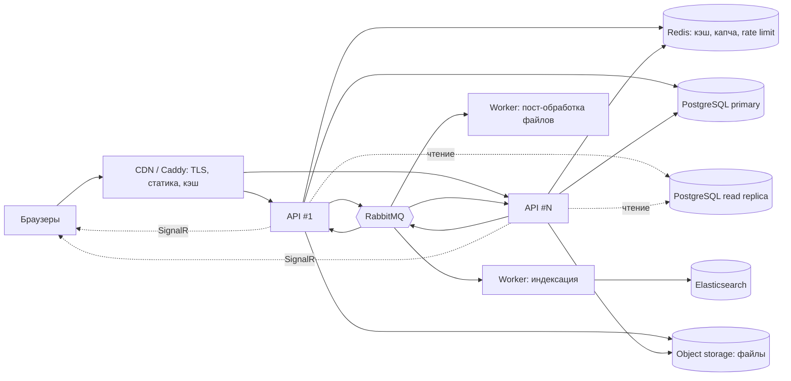

# Архитектура под нагрузку (уровень Middle+)

**Условие:** 1 000 000 сообщений и 100 000 пользователей в сутки.

> Все числа ниже — расчётные допущения, а не измерения. Реальные цифры даёт нагрузочный тест
> (`tests/load`) на целевом железе; пороги в нём заданы из этого документа.

## 1. Допущения и расчёт

| Параметр | Значение | Комментарий |
|---|---|---|
| Запись, среднее | 1 000 000 / 86 400 ≈ **12 сообщений/с** | |
| Запись, пик | **~120 сообщений/с** (×10) | закладываем с запасом до 150 |
| Активные пользователи | 100 000 / сутки | |
| Просмотров страниц на пользователя | ~20 / сутки | пагинация, сортировка, обновления |
| Чтение, среднее / пик | ~23 / **~230 запросов/с** | один запрос = страница + дерево ответов |
| Одновременно онлайн (SignalR) | 3–5 % DAU ≈ **3–5 тыс.** | |
| Размер записи комментария | ~1,2 КБ с индексами | текст + HTML + служебное |
| Рост таблицы `comments` | ~1,2 ГБ/сут ≈ **440 ГБ/год** (365 млн строк) | |
| Вложения | допустим 10 % сообщений × ~50 КБ ≈ **5 ГБ/сут** | ≈ 1,8 ТБ/год |

Вывод: **запись** (120/с) для PostgreSQL тривиальна. Реальные риски — в чтении при росте таблицы,
в рассылке live-событий и в хранении файлов.

## 2. Целевая схема

API без состояния: масштабируется количеством экземпляров. Состояние — только в Postgres, Redis, RabbitMQ,
Elasticsearch и объектном хранилище.

## 3. Узкие места и решения

| # | Проблема | Решение | Статус |
|---|---|---|---|
| 1 | **Сортировка по UserName/E-mail** по сотням миллионов корневых строк требует join с `users` и сортировки всего набора | Денормализовать `user_name`, `email` в корневые комментарии (или отдельная таблица `root_comments`) + индексы `(user_name, id)`, `(email, id)`; либо отдавать такие сортировки из Elasticsearch (`userName.raw`, `email`) | спроектировано |
| 2 | **OFFSET-пагинация** (`Skip/Take`) деградирует на глубоких страницах | Keyset-пагинация по `(created_at, id)`; номера страниц — только для первых N, дальше «следующая» | спроектировано |
| 3 | **Рост таблицы** (~365 млн строк/год) | Партиционирование `comments` по месяцам (`created_at`), архивирование старых партиций; `VACUUM`/autovacuum под нагрузку записи | спроектировано |
| 4 | **Кэш главной** сбрасывается каждой записью (12–120/с) — hit-rate около нуля | Для первой страницы — короткий TTL (1–2 с) без инвалидации + stale-while-revalidate; «точные» данные добирает live-канал. Single-flight, чтобы один промах не порождал лавину запросов | версионный кэш реализован; TTL-режим спроектирован |
| 5 | **Live-рассылка**: 120 событий/с × 5 тыс. клиентов = 600 тыс. сообщений/с с одного узла нереальны | (а) клиент применяет событие локально, а не перечитывает список — **реализовано**; (б) группы SignalR: подписка только у тех, кто смотрит первую страницу; (в) пакетирование: раз в 1 с одно сообщение с ≤25 новыми; (г) масштабирование хабов — Redis backplane или Azure SignalR | (а) реализовано, (б)(в)(г) спроектированы |
| 6 | **Потеря событий**: публикация в RabbitMQ после коммита БД | Transactional outbox (таблица `outbox` в той же транзакции + публикатор) | спроектировано |
| 7 | **Файлы на локальном диске** не масштабируются между узлами | `IFileStorage` → S3-совместимое хранилище, отдача через CDN, lifecycle-правила | интерфейс готов |
| 8 | **Ресайз картинок в запросе** (CPU) | Пост-обработка в Worker: сохранить оригинал, отдать плейсхолдер, подменить после ресайза; пока — синхронно с лимитами (5 МБ, 25 Мпикс) | спроектировано |
| 9 | **Антиспам** при открытой записи | CAPTCHA (есть), rate limit по IP (есть), далее — репутация IP, сигналы WAF | частично |
| 10 | **Поиск** | Elasticsearch (3 узла, реплики), индексация асинхронна и идемпотентна | реализовано (1 узел) |
| 11 | **Надёжность брокера** | Кворумные очереди RabbitMQ, dead-letter + алерт на глубину очереди | спроектировано |
| 12 | **Наблюдаемость** | Метрики (p95 latency, rps, глубина очередей, hit-rate кэша), OpenTelemetry-трейсы, алерты | спроектировано |

## 4. Что реализовано в коде, а что только спроектировано

Реализовано: stateless API, Redis (капча, кэш страниц, лимиты), RabbitMQ + Worker, Elasticsearch, SignalR с рассылкой
на все экземпляры API (временные очереди), локальное применение live-событий на клиенте, idempotent-индексация,
нагрузочный тест. Остальное — таблица выше (статус «спроектировано»); это осознанное решение: каждый пункт
оправдан только измерениями, которые даёт `tests/load` на целевой инфраструктуре.

## 5. Нагрузочный тест

См. README → «Нагрузочный тест». Профили:

| Профиль | Запись | Чтение | Команда |
|---|---|---|---|
| Средний день ×2,5 | 30 rps | 200 rps | по умолчанию |
| **Пик (требование)** | **120 rps** | **600 rps** | `-e WRITE_RPS=120 -e READ_RPS=600` |

Пороги (падение теста при нарушении): ошибок < 1 %, p95 чтения < 300 мс, p95 записи < 800 мс.
При нарушении смотреть по порядку: CPU/соединения Postgres → глубину очередей RabbitMQ (консоль `:15672`) →
лаг индексации в Elasticsearch → hit-rate Redis.
